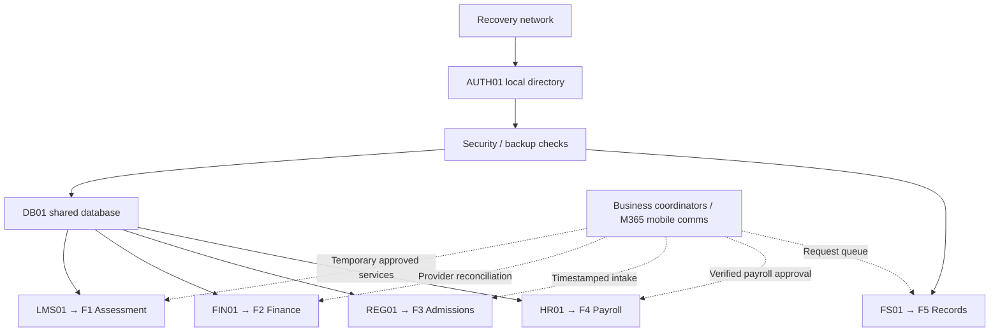

# Task 1 — Business Impact Analysis

**GRC205 | Northbridge Skills Institute | Task 1 of 6**  
**Status:** Complete — Stage 1 BIA and Stage 2 prioritisation/dependencies integrated; pending user review.

## 1. Scope, evidence and assumptions

At **08:00 WAT on Day 0 (Monday)**, flooding and a power failure render Northbridge's main site and local systems unavailable. Facilities estimates **72 hours** of site inaccessibility. The institute has **1,800 learners and 90 staff**. Microsoft 365 identity and email remain accessible through mobile internet, but locally hosted systems use a distinct directory, **AUTH01**. No cyberattack has been confirmed.

An alternative facility opens at **10:00 WAT** with **25 workstations**. At **11:00 WAT**, **120 learners** are due to sit an examination: **80** can use their own devices, while **40** require centre workstations. Thus, simultaneous on-site workstation demand exceeds the supplied capacity by **15**. The institute has **two recovery technicians**; business coordinators can arrange alternative services and learner support.

**Evidence basis:** ICDFA, *GRC205 BC/DR Assignment*, pp. 1–4 (scenario, function rates and constraints), and ICDFA, *Business Continuity and Disaster Recovery*, Week 21, slides 3 and 5 (BC versus DR and BIA methodology). The service arrangements, role assignments and controls proposed below are **planning assumptions**, not verified existing capabilities.

**Interpretation:** The hourly amounts are independent, non-overlapping incremental loss estimates. All functions remain disrupted in the requested 8-hour and 24-hour **no-recovery/no-continuity** calculations. Rates apply for the first 24 hours only; the examination's NGN 120,000 rescheduling charge is added once because an acceptable assessment service is unavailable at 11:00. Do not extrapolate these hourly rates beyond 24 hours.

## 2. Five-function BIA

The owners are **proposed accountable business roles**; actual appointments and delegations require management approval. “Users” describes the people or groups primarily affected, **not invented counts of active users**.

| Function / proposed owner | Users and time-sensitive impact | Critical resources, dependencies and information | Minimum acceptable continuity service and controls |
|---|---|---|---|
| **F1 — Teaching and assessment**; Academic Director / Examinations Lead | Scheduled examination: **120 learners at 11:00**; wider teaching services affect the learner body and tutors. **NGN 60,000/hour** plus **NGN 120,000 once** if the exam cannot proceed acceptably by 11:00. Welfare, reasonable adjustments, access equality and assessment validity are major non-financial impacts. | **LMS01 + DB01**, recovery network, **AUTH01**, tutors/invigilators, accessible premises, device capacity, connectivity, verified candidate roster, exam rules and protected question/answer materials. | Authorised examination continuity arrangement with verified identity, accessible delivery, controlled invigilation, time-stamped attendance and secure evidence capture. Examinations Lead must approve any changed modality, staggered session or rescheduling; maintain version-controlled candidate lists and a signed reconciliation/incident log. **25 devices cannot accommodate 40 concurrent centre-dependent candidates**; do not claim that merely using the alternate facility satisfies the deadline. |
| **F2 — Fees and finance**; Finance Manager | Payments still reach the external provider, but local receipt and wallet updates fail. **NGN 40,000/hour**; fee-confirmation deadline **16:00 Day 0**. Missed confirmation may disrupt learner access and financial assurance. | **FIN01 + DB01**, network, AUTH01, Finance staff, provider portal and statements, transaction IDs, controlled reconciliation ledger, dual-review access. | Provider-confirmed transactions logged in a restricted, numbered temporary register; clearly issue *provisional* acknowledgements rather than claiming a FIN01 receipt. Finance Manager approves exception handling; a second reviewer checks amounts and references. Reconcile every entry with provider evidence and restored DB01 before posting final receipts or balances. |
| **F3 — Admissions and registration**; Registrar / Admissions Lead | New applications and enrolment changes cannot be recorded locally; **NGN 20,000/hour**. Admissions close **18:00 Day 0**. Applicants may lose fair access if timestamps are not preserved. | **REG01 + DB01**, network, AUTH01, trained admissions staff, approved intake forms, submission timestamps, privacy notices and eligibility rules. | Restricted, timestamped temporary intake with unique reference numbers, applicant consent/notice, authorised access and a documented cutoff rule. Registrar approves exceptions; on restoration, double-check identity, duplicates, eligibility and order of submission before importing or accepting entries. |
| **F4 — Staff payroll**; HR/Payroll Manager | All **90 staff** are potentially affected; **NGN 10,000/hour**. Bank submission is due **12:00 Day 1**; inaccurate or duplicated instructions could cause material harm. | **HR01 + DB01**, network, AUTH01, payroll officers, verified change register, bank instructions, payment approval mandates and restricted salary records. | Prepare a controlled draft from the **last verified payroll** and documented authorised changes. HR Manager and Finance Manager provide separate approval before bank submission; prohibit unverified amendments and duplicate uploads. Retain authorisation, bank acknowledgement and a subsequent reconciliation trail. |
| **F5 — Records and certificates**; Records Manager | Requests from learners, alumni and staff risk delay; **NGN 5,000/hour**. Internal service commitment is **48 hours**. Document integrity, confidentiality and authenticity matter. | **FS01**, recovery network, AUTH01, records staff, approved retention rules, certificate templates, source registers, controlled access and chain of custody. | Provide verified status enquiries and log urgent requests in a restricted, uniquely numbered queue. Release a certificate or amended record **only where its source can be independently authenticated** and the Records Manager authorises release. Otherwise issue a transparent delay notice and reconcile queued requests after restoration. |

### Cross-cutting people, premises and supplier requirements

| Resource class | Minimum arrangements and unresolved assumptions |
|---|---|
| **People** | Business service owners, continuity coordinator, examination invigilators, learner-support/accessibility staff, Finance and HR dual approvers, registrar and records custodians; two technicians remain dedicated to the technical recovery schedule. **Staff availability and precise shift coverage are unverified.** |
| **Premises and equipment** | Secure alternate teaching/assessment space from 10:00; 25 supplied workstations, power, internet, accessibility measures, privacy for payroll and records, physical security, supervised devices and secure storage. Capacity shortfall: **40 − 25 = 15 workstations** for a simultaneous centre-based sitting. |
| **Suppliers** | Alternate-facility provider, external payment processor, offsite backup provider, network/mobile connectivity suppliers and bank. Confirm service-level commitments, business contacts, emergency access and evidence exports; these are **not established by the brief**. |
| **Information and controls** | Authoritative identity/candidate/payroll records, backup catalogue, assessment approvals, audit trails, receipt references, timestamped interim transaction logs, encryption, least-privilege access, dual review where financially material, retention and reconciliation on restoration. M365 mobile email supports coordination **but does not restore locally dependent applications**. |

## 3. Worked disruption impact calculations

**Model:** For function \(i\), cost \(C_i(t)=r_i\times t\) for \(t=8\) or \(24\) hours with no mitigation. For F1, add the examination rescheduling charge \(E=\text{NGN }120{,}000\) once when the **11:00** trigger is met. The 8-hour window runs **08:00–16:00 Day 0**; the 24-hour window runs **08:00 Day 0–08:00 Day 1**.

| Function | Hourly rate (NGN) | 8-hour working | 8-hour impact (NGN) | 24-hour working | 24-hour impact (NGN) |
|---|---:|---|---:|---|---:|
| **F1 Teaching/assessment** | 60,000 | 60,000 × 8 + 120,000 | **600,000** | 60,000 × 24 + 120,000 | **1,560,000** |
| **F2 Fees/finance** | 40,000 | 40,000 × 8 | 320,000 | 40,000 × 24 | 960,000 |
| **F3 Admissions/registration** | 20,000 | 20,000 × 8 | 160,000 | 20,000 × 24 | 480,000 |
| **F4 Payroll** | 10,000 | 10,000 × 8 | 80,000 | 10,000 × 24 | 240,000 |
| **F5 Records/certificates** | 5,000 | 5,000 × 8 | 40,000 | 5,000 × 24 | 120,000 |
| **Combined** | **135,000** | **(135,000 × 8) + 120,000** | **1,200,000** | **(135,000 × 24) + 120,000** | **3,360,000** |

**Checks:** Sum of base hourly rates = \(60{,}000+40{,}000+20{,}000+10{,}000+5{,}000=\text{NGN }135{,}000\). Eight-hour baseline = NGN **1,080,000**, plus NGN **120,000** once = NGN **1,200,000**. Twenty-four-hour baseline = NGN **3,240,000**, plus NGN **120,000** once = NGN **3,360,000**. The extra examination cost **must not** be added a second time at 24 hours.

### Interpretation and limitations

1. **Simplified financial model:** Rates are stipulated teaching-case estimates and deliberately independent; they do not reflect real transaction volumes, changing demand, effective workarounds, insurance recoveries, avoided expenses or any escalation after 24 hours. Neither sum is an observed loss or a forecast of a 72-hour or five-day outage.
2. **Incomplete total impact:** The model excludes learner welfare and accessibility, potential unfair treatment at the 11:00 examination, loss of academic confidence, institutional reputation, confidentiality and integrity consequences, regulatory exposures and the risk of incorrect payroll or duplicate finance entries. These effects cannot responsibly be inferred from the supplied hourly rates.

## 4. Business recovery priority and time-critical decisions

**Priority rule:** Rank the business **service outcome**, first by the earliest consequential deadline and learner harm, then by incremental cost and integrity exposure. The ranking is an analytical proposal for management approval, **not** a statement that the application can be restored in that order. Temporary continuity decisions may occur while technicians restore shared infrastructure.

| Business priority | Function | Why this priority is justified | Decision / minimum-service milestone |
|---:|---|---|---|
| **1** | **F1 Teaching and assessment** | Highest hourly loss (**NGN 60,000**), immediate **11:00 Day 0** examination and fairness/accessibility risks; one-off **NGN 120,000** rescheduling trigger. | Before **11:00**, Examinations Lead either certifies an accessible, invigilated and authorised examination solution or approves and communicates fair rescheduling. **40** learners need centre equipment but only **25** workstations are supplied: a **15-device gap**. |
| **2** | **F2 Fees and finance** | Next-largest hourly exposure (**NGN 40,000**), external payments still occur while local confirmation is unavailable; **16:00 Day 0** deadline. | By **16:00**, begin approved provider-verified provisional confirmations with unique IDs and two-person review; do not mark local DB01 balances as final until reconciled. |
| **3** | **F3 Admissions and registration** | **18:00 Day 0** closing time; losing verified timestamps could unfairly reject applicants even where the hourly rate (**NGN 20,000**) is lower than F2. | By **18:00**, enforce an approved, timestamped and privacy-controlled temporary intake/cutoff process. |
| **4** | **F4 Staff payroll** | Although payroll affects **90 staff**, its bank submission deadline is **12:00 Day 1**, later than F1–F3; incorrect or duplicated instructions have disproportionate integrity consequences. | Before **12:00 Day 1**, prepare and dual-authorise the bank file against verified payroll evidence; prevent duplicate submission. Escalate earlier if the approval lead time is insufficient. |
| **5** | **F5 Records and certificates** | Lower incremental rate (**NGN 5,000/hour**) and **48-hour** commitment; nonetheless authenticity, confidentiality and urgent access requests require controls immediately. | From activation, log requests and respond to enquiries; issue records only after authoritative verification and Records Manager approval. |

**Priority qualification:** Payroll integrity or an urgent safeguarding/records matter may require escalation above its default ranking. This changes the **business decision queue**, not the system dependency sequence. The supplied 8-hour/24-hour cost model remains a *no-continuity* comparator; the above proposals do not retroactively reduce those calculated estimates.

### Business deadlines versus technical recovery

The shared technical restoration sequence is **network → AUTH01 → security/backup checks → DB01 → LMS01/FIN01/REG01/HR01**, with **FS01** branching after security/backup checks without needing DB01. The assessment service cannot be declared technically restored merely because the DB01 restore finishes; LMS01 must also complete validation, then an authorised business owner must accept the examination service.

For planning orientation only, the supplied sequential prerequisites require **30 + 30 + 30 + 90 + 45 = 225 minutes**, giving **11:45 WAT** as the earliest modelled LMS01 completion from **08:00**, even before any additional business acceptance or room/device validation. Thus technology alone **cannot** secure the **11:00** examination. Task 5 will schedule every action against the two-technician limit; this arithmetic is **not** a claim of a live recovery test.

Business coordinators should work **in parallel** on the examination decision, payment-provider reconciliation, admissions intake and payroll preparation while technical staff rebuild the prerequisite systems. Any parallel activity must use distinct staff, controlled information access and documented approvals.

## 5. Dependency risks and control requirements

| Risk | Failure mode and consequence | Proposed control and response | Accountable role |
|---|---|---|---|
| **D1 — Shared DB01 bottleneck** | F1–F4 all depend on one database; failed or corrupt restoration delays four services simultaneously. | Validate the full-plus-incremental chain before recovery; retain protected fallback checkpoints; test restores and verify application-level data integrity. **Do not assume** a checkpoint passed until checked. | DR Lead |
| **D2 — AUTH01 and identity concentration** | Local AUTH01 loss blocks all five local functions; Microsoft 365 email access does **not** substitute for local authentication. | Restore and test AUTH01 before dependent services; use pre-authorised, monitored emergency access with separation of duties, expiring credentials and logged approval. | DR Lead / Identity Administrator |
| **D3 — Facilities and device shortfall** | Flood damage and site outage prevent local access; 25 alternate computers cannot simultaneously serve 40 centre-dependent examination learners. | Confirm safe/accessible premises, power and connectivity; secure **15 additional verified devices** or obtain explicit approval for a feasible alternative, with equality and exam-integrity checks. Unfunded capacity is **not assumed available**. | Facilities Lead / Examinations Lead |
| **D4 — Two-technician capacity** | Shared restore tasks and competing application work contend for only two technicians; assigning a third technician or overlapping occupied work is invalid. | Use a dependency-aware, non-preemptive two-person schedule; have business coordinators perform temporary continuity work independently. | BC/DR Coordinator |
| **D5 — Backup-admin and supplier access** | Production and network backup administration share an identity; provider access-independence controls are undocumented. Flood recovery could encounter unusable/compromised offsite copies. | Investigate supplier assurances, independent credential custody, offline/immutable backup and integrity validation; isolate suspected compromise and escalate to IR if evidenced. | DR Lead / Information Security Lead |
| **D6 — Interim records and reconciliation** | Provider payments, admissions entries and payroll approvals can diverge from restored local data, causing duplicates, omissions or unauthorised disclosure. | Number and timestamp interim transactions; apply dual authorisation, restricted storage and reconciled import with documented exception resolution and business-owner sign-off. | Finance Manager / Registrar / HR Manager |

### Compact dependency diagram

The following Mermaid diagram is **a planning depiction**, not a measured recovery trace. Service owners retain business acceptance authority after technology is validated.

**Interpretation:** Solid arrows represent required **technical prerequisites** (the security/backup check prerequisite for FS01 is preserved); dashed arrows indicate **continuity coordination**, not restoration of unavailable applications. Other required conditions—including people, privacy controls, alternate premises, suppliers and owner validation—remain in the five-function BIA.

## 6. Task 1 marking-rubric self-check

| Rubric element (20 marks) | Evidence in this README | Assessment |
|---|---|---|
| **Complete BIA and minimum service — 6 marks** | Five owner-led function rows; users, deadlines, resources, shared systems, minimum services and approvals; people, premises, suppliers, information | Addressed; staffing availability and supplier commitments clearly unverified |
| **Correct impact calculations — 8 marks** | Function-by-function 8-hour and 24-hour workings; totals **NGN 1,200,000** and **NGN 3,360,000**; once-only exam charge; two model limitations | Addressed; clearly marked hypothetical estimates |
| **Justified priorities and dependency risks — 6 marks** | Ranked F1–F5 with deadline logic, business-versus-technical distinction, six controlled risks and Mermaid dependency map | Addressed; 11:45 baseline is planning arithmetic, not a completed restoration |

**Review disposition:** All specified Task 1 deliverable categories are documented. Formal grading remains with the assessor; objectives and detailed technician scheduling will be developed in Tasks 2 and 5 respectively. No live testing, purchased recovery service or real-world data loss is claimed.

## References

- ICDFA (n.d.). *GRC205 Incident Management and Business Continuity: Business Continuity and Disaster Recovery Assignment*, pp. 1–5, Task 1 and business context (provided assessment brief).
- ICDFA (n.d.). *Business Continuity and Disaster Recovery*, GRC205 Week 21 teaching slides, especially slides 3, 5, 6 and 8 (provided teaching deck).

[Back to repository overview](../README.md)
