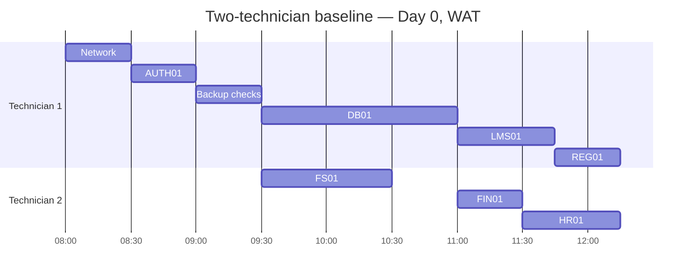

# Task 5 — Recovery Schedule and Tabletop Exercise

**GRC205 | Northbridge Skills Institute | Task 5 of 6**  
**Evidence status:** **MODELLED BASELINE** and separate **SIMULATED TABLETOP** only. No live systems, personnel or premises were tested.

## 1. Scheduling rules and assumptions

The fictional flood/power incident begins **08:00 WAT Day 0**. Only **two technicians (T1 and T2)** are available. Every listed action uses **one technician for its full uninterrupted duration**; parallel actions require completed prerequisites and a free technician. The specified durations **already include local technical validation**. In this *baseline model*, B01–B04 backup integrity checks **pass as stipulated by the assignment**. No unlisted task, accelerated restore, additional technician or extra parallelism is assumed.

**Technical precedence:** Network → AUTH01 → Security/backup checks → **DB01** → LMS01, FIN01, REG01, HR01. **FS01** requires AUTH01 **and** security/backup checks, but **not DB01**. A service's technical completion is recorded after its application/file restore action ends. **Business minimum-service acceptance, temporary workarounds, candidate readiness and reconciliations are not automatically proved by these technical completions.**

## 2. Earliest feasible two-technician schedule — baseline

| Action | Technician | Start WAT | Finish WAT | Duration | Prerequisite(s) |
|---|---|---|---|---:|---|
| Recovery network | **T1** | 08:00 | 08:30 | 30 min | None |
| AUTH01 restoration | **T1** | 08:30 | 09:00 | 30 min | Recovery network complete |
| Security and backup checks | **T1** | 09:00 | 09:30 | 30 min | AUTH01 complete |
| DB01 restoration | **T1** | 09:30 | 11:00 | 90 min | Security/backup checks complete |
| FS01 restoration | **T2** | 09:30 | 10:30 | 60 min | AUTH01 and security/backup checks complete |
| LMS01 restoration | **T1** | 11:00 | 11:45 | 45 min | DB01 complete |
| FIN01 restoration | **T2** | 11:00 | 11:30 | 30 min | DB01 complete |
| HR01 restoration | **T2** | 11:30 | 12:15 | 45 min | DB01 complete |
| REG01 restoration | **T1** | 11:45 | 12:15 | 30 min | DB01 complete |

**Explicit technician availability check:**

- **T1:** 08:00–08:30 Network → 08:30–09:00 AUTH01 → 09:00–09:30 Checks → 09:30–11:00 DB01 → 11:00–11:45 LMS01 → 11:45–12:15 REG01. **No overlaps.**
- **T2:** 09:30–10:30 FS01 → idle until 11:00 → 11:00–11:30 FIN01 → 11:30–12:15 HR01. **No overlaps.**

**Assessment earliest finish and controlling dependency path:**  
08:00 → Network **30** → AUTH01 **30** → Checks **30** → DB01 **90** → LMS01 **45** = **225 minutes = 3 h 45 min**, hence **11:45 WAT**. No free technician can bypass this sequential dependency path.

**All-five technical completion:** **12:15 WAT = 255 minutes = 4 h 15 min** after disruption. This is **optimal under the given constraints**: after DB01 becomes available at **11:00**, the four dependent application actions require **45 + 30 + 30 + 45 = 150 technician-minutes** across two technicians. Even an ideal non-preemptive allocation needs **at least 150 ÷ 2 = 75 minutes**, and the schedule achieves exactly **11:00 + 75 minutes = 12:15**. FS01 is completed separately at 10:30 and does not extend that makespan.

### Visual schedule (modelled, WAT)

*The calendar date in the Mermaid Gantt is an **arbitrary diagram placeholder for a Monday**, not the actual date of a disaster or test. The authoritative baseline uses relative Day 0 and the WAT times in the schedule table.*

## 3. Modelled recovery objectives versus baseline

[Task 2](../02-recovery-objectives-backups/) distinguishes *business minimum-service RTOs* from *application-level DR completion*. The table below compares **technical completions** against those numerical RTO and MTD targets as a **conservative technical-only test**. An alternative authorised continuity process may satisfy a business RTO earlier but has **not been performed or demonstrated** in this model.

| Function | Restored technical component | Baseline completion | Elapsed from 08:00 | Proposed RTO | Proposed MTD | Technical comparison |
|---|---|---|---:|---:|---:|---|
| **F1 Teaching/assessment** | LMS01 | **11:45 Day 0** | **3 h 45 min** | 2 h | 3 h | **RTO missed by 1 h 45 min; MTD missed by 45 min** |
| **F2 Fees/finance** | FIN01 | **11:30 Day 0** | **3 h 30 min** | 4 h | 8 h | **RTO met (30 min margin); MTD met** |
| **F3 Admissions** | REG01 | **12:15 Day 0** | **4 h 15 min** | 6 h | 10 h | **RTO met (1 h 45 min margin); MTD met** |
| **F4 Payroll** | HR01 | **12:15 Day 0** | **4 h 15 min** | 20 h | 28 h | **RTO met (15 h 45 min margin); MTD met** |
| **F5 Records** | FS01 | **10:30 Day 0** | **2 h 30 min** | 24 h | 48 h | **RTO met (21 h 30 min margin); MTD met** |

**Service declaration qualification:** The outcomes above are **application/file technical readiness only**. Formal service recovery requires the owner-approved minimum-service gates, secure access, and record controls defined in Tasks 2 and 4. No measured business-acceptance durations are supplied, so actual accepted service times **cannot** be calculated or certified from this data.

### Baseline checkpoint ages and proposed RPOs

At the **08:00** disruption, the baseline assumed-valid recoverable DB01 point is **07:00 (age 1 h)** after B01 full plus the complete B02 incremental chain. AUTH01 is **00:00 (age 8 h)** and FS01 is **23:00 Day −1 (age 9 h)**. The DB01 full alone is **9 h** old; the disconnected fallback at **17:00 Day −3 is 63 h** old.

| Function | Proposed RPO | Required checkpoint(s) and age at 08:00 | Result in modelled baseline |
|---|---:|---|---|
| **F1** | **15 min** | DB01 **1 h**; AUTH01 **8 h** | **Miss:** DB01 by 45 min, AUTH01 by 7 h 45 min |
| **F2** | **30 min** | DB01 **1 h**; AUTH01 **8 h** | **Miss:** DB01 by 30 min, AUTH01 by 7 h 30 min |
| **F3** | **1 h** | DB01 **1 h**; AUTH01 **8 h** | **DB01 age exactly meets**; AUTH01 misses by 7 h |
| **F4** | **4 h** | DB01 **1 h**; AUTH01 **8 h** | **DB01 age meets**; AUTH01 misses by 4 h |
| **F5** | **24 h** | FS01 **9 h**; AUTH01 **8 h** | **Age targets met**, conditionally on valid/restorable checkpoints |

**Methodological caution:** As in Task 2, a conservative comparison applies each function's RPO to its **AUTH01 identity dependency** as well as application/record data. This is a proposed policy choice, not an assertion that identity data and transactional data carry identical risk. Passing a checkpoint-age test does not verify application correctness or reconstruct transactions after that checkpoint. The tabletop deliberately invalidates the DB01 integrity assumption, and **must not overwrite these baseline figures**.

### Deadlines requiring business continuity measures

- **11:00 Day 0 examination:** LMS01 completes only **11:45** even in the successful model, and **25 workstations** from 10:00 cannot simultaneously serve **40** centre-dependent candidates. Academic leadership must verify an authorised accessible alternate assessment with the 15-device shortfall resolved or approve fair rescheduling. If no acceptable service exists by 11:00, the brief imposes the **NGN 120,000 one-off** rescheduling estimate.
- **16:00 Day 0 fee confirmation:** FIN01 is technically available by 11:30 in the model, but finance must still reconcile provider-paid transactions, apply dual review and protect against missing/duplicate records; the temporary provider-backed acknowledgment workflow remains necessary.
- **18:00 Day 0 admissions cutoff:** REG01 finishes 12:15 technically, but time-stamped interim submissions and policy-approved closure/appeal rules are required for fair processing.
- **12:00 Day 1 bank payroll submission:** HR01 finishes 12:15 Day 0 technically; independently authorised bank instructions, changed pay details and duplicate-submission checks remain mandatory.
- **48-hour record request commitment:** FS01 may restore 10:30 technically but records authenticity and ACLs must be validated and urgent requests tracked pending owner approval.
- **72-hour site closure:** Restoring systems in a warm location does **not** make the flooded main site safe; alternate teaching accommodation and safe return require separate Facilities/Executive sign-off.

## 4. Forty-five-minute tabletop — SIMULATED stress scenario

**Exercise type:** Facilitated **discussion-based** walkthrough, **45 minutes** in relative exercise time. All participant roles below are **simulated individually** by the report author as permitted by the assignment. **No live restore, actual supplier contact, learner messaging or real transaction manipulation was undertaken.** This stress exercise changes key assumptions **only within its own scenario**, not the modelled baseline of Sections 1–3.

**Simulated roles:** Incident Commander (Executive Sponsor); BC/DR Coordinator (facilitator/scribe); Academic Director; Facilities Lead; DR Lead with two technician positions; Information Security/IR Lead; Finance Manager; Registrar; HR/Payroll Manager; Records Manager; Communications Lead. Decisions are hypothetical and subject to owner approval in a real incident.

| Exercise minute | Inject / simulated finding | Simulated decision, owner and rationale | Revised action and service/recovery impact |
|---|---|---|---|
| **10** | Facilities reports **72-hour closure extended to five days (120 h)**. | **Incident Commander**, advised by Facilities and BC: maintain campus exclusion, extend continuity period, and require a welfare/availability review. A site-return date must not be treated as guaranteed. | **Facilities Lead** confirms alternate facility coverage, accessible seating, power and security for five days; **BC Lead** revises staff coverage and supplier bookings; **Communications Lead** issues an approved change notice. **Effect:** longer reliance on alternate services, supplier cost/exposure and need for daily review; technical baseline timings remain unchanged. |
| **20** | Alternate facility capacity falls from **25 to 15 working workstations**. | **Academic Director**, for exam provision with **Incident Commander** authorisation for any change: do not assert that 40 centre-dependent candidates can be accommodated. Prioritise accessibility/fairness and examination integrity over an unverified seating plan. | Recalculate simultaneous deficit: **40 − 15 = 25 devices**; request **25 additional tested devices** and accessible alternative space, assess an approved non-concurrent arrangement only if integrity and equality permit, otherwise authorise and communicate equitable rescheduling. **Effect:** the 11:00 examination remains at material risk, including the one-off charge if acceptable service is unavailable. |
| **30** | One **DB01 incremental fails integrity**; an **unexpected backup administrator logon** is discovered. | **DR Lead** stops use of the untrusted DB01 chain; **Information Security/IR Lead** starts security triage and preserves immutable logs. **Incident Commander** escalates loss of confidence in recovery-point integrity. These indicators justify **investigation**, not a claim that a cyberattack is proven. | Quarantine affected increments and relevant credentials, validate independently controlled copies and determine the latest **complete, contiguous, verified chain**; if none exists, examine **B01 23:00 Day −1 (9 h old)** or **disconnected 17:00 Day −3 (63 h old)** only after documented owner risk acceptance. Rebuild schedule and RPO assessment **when** a proven usable recovery point and new duration become known. **Effect:** B02 07:00 is **no longer assumed valid** in stress case; DB01-dependent F1–F4 technical times and data gaps are **unknown**, not copied from baseline. FS01 may remain separately recoverable subject to security checks. |
| **40** | Provider confirms successful payments **missing from restored FIN01 records**. | **Finance Manager**, consulting DR/IR: do not fabricate DB01 entries or issue final receipts solely from a payment assertion; begin exception-controlled reconciliation. | Obtain verified provider transaction IDs, amounts and timestamps; compare with restored DB01, bank settlements and interim numbered ledger; apply independent review, avoid duplicate credit and document unresolved payments. Escalate systemic data gaps to IC and revise fee-confirmation notices. **Effect:** FIN01 technology availability is **not** accepted as restored finance business service until reconciliation and owner sign-off; exact number/value of discrepancies is **not provided**. |

### Minute 45 simulated closure and decision record

**BC/DR Coordinator** presents the unresolved issues to the simulated Incident Commander: prolonged alternate-site dependence, 25-device examination shortfall, untrusted incremental chain and admin logon, and unreconciled provider payments. The Commander *conditionally* approves continued temporary services, forbids promotion of unverified DB01 data, directs IR review and requires formal service-owner acceptance before resumption.

**Stress-outcome assessment:** The baseline's 11:45 LMS01 and 12:15 all-function results **cannot be carried over** after the minute-30 incremental failure. A new DB01 finish time, application recovery finish, and exact data-loss value **cannot** be computed from the inject because the identity of the corrupt increment, validity of alternatives and re-restore duration are not supplied. Any new times asserted without evidence would be fabricated. The five-day closure and 15-workstation scenario apply **only to the stress exercise**.

## 5. Corrective-action register — proposed, not implemented

**Clock convention:** Target deadlines below are **relative to the simulated exercise close (“Exercise Day +N”)**, not claims about actual calendar dates or completed corrective work. Priority **P1** means an urgent objective/safety/integrity blocker; **P2** denotes an important programme control.

| ID | Priority | Corrective action | Accountable owner | Target date | Measurable closure evidence |
|---|---|---|---|---|---|
| **CA01** | **P1** | Prepare and validate **five-day** alternate-site occupancy, utilities, accessibility, learner support and supplier contacts. | Facilities Lead | **Exercise Day +7** | Signed site readiness checklist; supplier confirmation of **≥120-hour** availability; BC/DR Coordinator review. |
| **CA02** | **P1** | Close the centre-device shortfall for **40** candidates even if only **15** venue machines work, or approve a defensible alternate examination model. | Academic Director | **Exercise Day +7** | Inventory/functional test for **40 accessible candidate stations** (15 venue + 25 confirmed additional) **or** documented, approved equitable alternative with invigilation and candidate communications drill. |
| **CA03** | **P1** | Prove DB01 full/incremental chain validation, automated fail-closed alerts, verified fallback point and an isolated restore. | DR Lead | **Exercise Day +14** | Recorded restore from a verified chain; integrity results for every required increment; timestamped achieved RPO and restore duration; evidence of failing-chain rejection. |
| **CA04** | **P1** | Remove shared production/backup administrative identity and verify independence/monitoring of offsite privileged access. | Information Security Lead | **Exercise Day +14** | Separate tested privileged roles/MFA where supported; signed provider access-independence test; alert and preserved log evidence for suspicious logon. |
| **CA05** | **P1** | Test provider-to-FIN01 payment reconciliation with missing and duplicate transaction cases. | Finance Manager | **Exercise Day +14** | 100% of test transaction IDs accounted for or exception-coded; dual-signed reconciliation register; no duplicate credits in test ledger. |
| **CA06** | **P2** | Update the two-technician runbook for point-in-time fallback, delay recalculation and alternate staffing escalation. | BC/DR Coordinator | **Exercise Day +21** | Version-controlled runbook; witnessed tabletop demonstrating resource and precedence compliance; owner-approved exception path. |
| **CA07** | **P2** | Reassess RTO/RPO/MTD and the warm-site supplier agreement in light of the 11:00 examination and security constraints. | Executive Sponsor | **Exercise Day +30** | Signed risk-acceptance/mitigation decision, approved RTO/RPO revisions only if justified by BIA, and supplier test/contract evidence. |
| **CA08** | **P2** | Conduct a follow-up exercise on prolonged closure, accessibility, learner notices and controlled return. | BC/DR Coordinator | **Exercise Day +30** | 45-minute exercise log, role attendance/assumed-role register, sampled communications approval and tracked closure of findings. |

**Corrective action progress:** **0 of 8 verified closed** because actions are **proposals arising from a hypothetical tabletop**, not observed programme activity. This is not a claim that real Northbridge staff failed to perform their work. The governance KPI dashboard in Task 6 should use this register as **exercise-generated illustrative input**, not actual institutional performance.

## 6. Schedule and result validation checks

| Rubric check (Task 5, 15 marks) | Evidence |
|---|---|
| Two-technician feasible action schedule, prerequisites, critical assessment path, baseline objective comparison **(7)** | Nine indivisible scheduled actions, zero technician overlaps, **11:45 LMS01**, **12:15 all-five**, per-function elapsed times/RTO/MTD/RPO, exam and business workaround requirements |
| Four injects with decisions, rationale and service effects **(4)** | Separate 45-minute tabletop log at **minutes 10, 20, 30, 40**; owner and revised action for each; minute-45 closure |
| Five or more corrective actions with owner, priority, target date and evidence **(4)** | **Eight** tracked actions CA01–CA08, relative exercise dates and measurable sign-off criteria |

**Methods disclaimer:** The embedded Gantt illustrates only the hypothetical Day 0 baseline; the displayed calendar date is illustrative and **not** a reported incident date. A successful baseline backup integrity assumption is invalidated **only in the minute-30 stress inject**. Neither the schedule nor the tabletop is represented as a live recovery test or authenticated observed result.

## References

- ICDFA (n.d.). *GRC205 Business Continuity and Disaster Recovery Assignment*, Week 21, pp. 3–7: recovery action durations/prerequisites, two technicians, baseline assumption, Task 5 and four exercise injects.
- ICDFA (n.d.). *Business Continuity and Disaster Recovery*, GRC205 Week 21 teaching slides **6, 8, 10–11 and 13–14**: RTO/RPO/MTD, backups, test methods, performance measurement and incident-response coordination.
- NIST (2010). *Contingency Planning Guide for Federal Information Systems*, NIST SP 800-34 Rev. 1. https://doi.org/10.6028/NIST.SP.800-34r1.

[Task 4 — Continuity and Recovery Plan](../04-continuity-recovery-plan/) · [Repository overview](../README.md)
